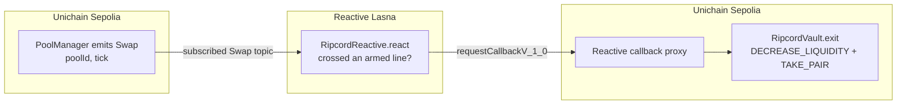

<p align="center">
  
</p>

# Ripcord

### Your Uniswap v4 position leaves the pool within 3 seconds of crossing your line, with nothing of yours running.

[](https://github.com/emmanuelist/ripcord/actions/workflows/ci.yml) [](https://github.com/emmanuelist/ripcord/actions/workflows/ci.yml) [](#limits) [](https://ripcord-ashy.vercel.app)

**[Live app](https://ripcord-ashy.vercel.app)** · **[Why Omni](#why-it-needs-omni)** · **[Proof](#proof-nothing-here-is-a-mockup)** · **[Run a loop](#run-a-loop-yourself)** · **[Verify it yourself](#verify-without-trusting-this-readme)** · **[How it works](#how-it-works)** · **[Limits](#limits)** · **[Run it locally](#run-it-locally)**

Measured on testnet: 50 of 50 real loops exited within 3 seconds of the crossing swap (median 2 s), on Unichain's own clock.

## The problem

A Uniswap v4 position earns only while the price stays in its range. When the price runs through, an LP wants out at a level they chose, the way a stop works on an exchange. But v4 has no native stop: removing liquidity is a transaction somebody has to send. So the usual answer is a keeper, a bot or a server or an open tab that watches the pool and holds a key, and the position is only as safe as that machine's uptime.

Ripcord removes the keeper. The owner approves a vault on their position NFT and arms a line once. A Reactive contract on Reactive Lasna subscribes to that pool's `Swap` events, compares every new tick with the armed lines, and when one is crossed asks Reactive to call the vault back on Unichain. The vault removes all of the position's liquidity and sends both tokens to whoever holds the NFT. After arming, nothing the owner runs takes part. Take Reactive's event subscription and cross-chain callback away and the keeper comes back: that is the part this needs Reactive for.

## Why it needs Omni

A loop has three hops: the swap on Unichain, the reaction on Lasna, the exit on Unichain. Reactive adds the middle one. Across 49 measured runs, the Lasna reaction was first seen a median 1.8 s after the swap was mined, and the whole loop took a median 2 s on Unichain's clock. On Reactive's previous version, blocks came every ~7 s (the organizers' own figure), so the reactive hop alone could take up to ~7 s before a callback was even requested.

What do those seconds cost an LP? Take the worst half hour of the 10 October 2025 crash, when ETH fell from 3,870 to 3,590 between 21:00 and 21:30 UTC, at one-second resolution. From any second, ETH fell a median **15.7 bps within the next 3 s**, Ripcord's slowest loop, and **25.0 bps within 7 s**, one legacy block (mean 33 vs 48 bps; 95th percentile 114 vs 157 bps). An exit at 3 s instead of 7 s kept about 15 bps on an average second of that crash, around $150 on a $100k position, and about 44 bps in the worst 5% of seconds. In the single most violent second, a 419 bps wick, no latency would have helped.

These are exchange price moves (Binance ETH/USDT spot), not a v4 pool: they measure how far the price runs while you wait. Reproduce them with [`harness/scripts/what-one-second-buys.sh`](harness/scripts/what-one-second-buys.sh), which downloads Binance's public 1-second candles, checks Binance's SHA-256 and recomputes ([E-018](docs/evidence/E-018-what-one-second-buys.json)).

## Proof: nothing here is a mockup

Everything below is live on testnet now. Click it.

- **The app:** [ripcord-ashy.vercel.app](https://ripcord-ashy.vercel.app). It has no backend: every value is read from Unichain Sepolia and Lasna in your browser, from the transactions listed below and from live polling.
- **The contracts:** [RipcordVault](https://sepolia.uniscan.xyz/address/0x641413bb227c5452ef2b968c9774bc31f5f54c98) on Unichain Sepolia and [RipcordReactive](https://lasna.reactscan.net/address/0xA2deA4D676236Aa905c0Cb1B90712Fc3591af2B5) on Reactive Lasna, plus [RipcordTryout](https://sepolia.uniscan.xyz/address/0xfDF1b11aae05a8a0620Fe56AD3C9A2Bd7431A698), which lets anyone [run a loop](#run-a-loop-yourself).
- **Every claim, with its proof:** [`docs/EVIDENCE.md`](docs/EVIDENCE.md) has a row for every factual sentence on the page and in this README, and the raw receipts are in [`docs/evidence/`](docs/evidence/).

### Fifty real loops

A real swap crosses an armed line, RipcordReactive reacts on Lasna, and the vault exits on Unichain. Seconds are counted from the crossing swap's block to the exit's block, on Unichain's clock.

**1 s in 1 loop, 2 s in 42, 3 s in 7: median 2 s, p90 3 s, max 3 s. 50 of 50 within 3 seconds.** The fastest, #7977, exited in the block right after its swap. Sources: [E-019](docs/evidence/E-019-fifty-loops-2026-11-14.md) (with [E-012](docs/evidence/E-012-ten-loops-2026-11-06.md) and [E-013](docs/evidence/E-013-v3-live-run-7954-2026-11-06.md)).

<details>
<summary>All fifty, with the swap, Lasna reaction and exit of each</summary>

| Position | Swap (Unichain) | Reaction (Lasna) | Exit (Unichain) | Swap → exit |
|---|---|---|---|---|
| #7944 | [0x88de…1262](https://sepolia.uniscan.xyz/tx/0x88dea6df04ee3a74b8b0020a6dc3a5f796930fca73559c74037f5ed6a2031262) | [0x8636…f892](https://lasna.reactscan.net/tx/0x86364e500098f45f4a3a854db410345a85201109ac33975afe27e896fe0af892) | [0x31a5…b119](https://sepolia.uniscan.xyz/tx/0x31a5b83cba4bb5ee28bdadd8b6d4ee8e60a0193443434515754286d09657b119) | 2 blocks, 2 s |
| #7945 | [0x82f6…e790](https://sepolia.uniscan.xyz/tx/0x82f67bb74643666ffc105e3626371b6af0906ec09fefdb6f83df64e300f7e790) | [0x5784…dfc6](https://lasna.reactscan.net/tx/0x5784fc4a5a0375750f9ced2df8cdd7cbed79cafef2811d427ca350eeb00cdfc6) | [0x614a…ab72](https://sepolia.uniscan.xyz/tx/0x614a6de33ad8b7cb66b6535481cddda1d8459463e7ce556b8c770f3e434fab72) | 3 blocks, 3 s |
| #7946 | [0x7195…c7af](https://sepolia.uniscan.xyz/tx/0x7195deb7990ca9425ff6c03ce345223bc9b67b3525c763a5dddb05bb5befc7af) | [0xc6ae…942c](https://lasna.reactscan.net/tx/0xc6aeaa32b8673489716ea6212bb89f9b5c97bc764c92d3493a8803a4a390942c) | [0x330e…c18b](https://sepolia.uniscan.xyz/tx/0x330ee41f74ec34dff8f759437eea34a9f4327f976bdab42901c85c95e274c18b) | 3 blocks, 3 s |
| #7947 | [0x97da…9188](https://sepolia.uniscan.xyz/tx/0x97da54b9cb8dc11396eeb5494560c7873ce3d6aeca3a293017a77e359bc99188) | [0xefeb…c891](https://lasna.reactscan.net/tx/0xefebbac656d9eef06519bff44f408f1aa04708fcf7adcc5d5e4c3ff9b0a1c891) | [0x7fbd…410d](https://sepolia.uniscan.xyz/tx/0x7fbd296f1992d444a23241e79d925a6840ea178c31370b4fcfb6a7f14775410d) | 2 blocks, 2 s |
| #7948 | [0x9c90…be1b](https://sepolia.uniscan.xyz/tx/0x9c904be64d98c01d905789652018ba9c6148ea59492b6c5a38fe280ac183be1b) | [0xc90f…5b7e](https://lasna.reactscan.net/tx/0xc90f5d6fcdfeb8491dd92162d9f4b09d5c592412e08f3dc914ef822bc8f45b7e) | [0x796e…adda](https://sepolia.uniscan.xyz/tx/0x796e38e0ca23867b4246248410ec0c9b4b687e379e519568f17c88f00817adda) | 3 blocks, 3 s |
| #7949 | [0xb62a…b954](https://sepolia.uniscan.xyz/tx/0xb62a1d5c5ba63f2e41dc7c4c7bb3e1dbe6ce06015d9f44caa75c04332335b954) | [0x573f…0db4](https://lasna.reactscan.net/tx/0x573f3897bb0e1c627c93512315fede799e809690f7d31b0f5bd0a6a7c9ec0db4) | [0x269b…f20a](https://sepolia.uniscan.xyz/tx/0x269bb1d39841de0147000732fa874ad939bfaab019f7cec3c7ffe1d5880ff20a) | 2 blocks, 2 s |
| #7950 | [0xe8e9…ecef](https://sepolia.uniscan.xyz/tx/0xe8e9f268123987982c182f13ece7adafb607970f23730ae5dd28a76455f1ecef) | [0x5726…5e72](https://lasna.reactscan.net/tx/0x5726d691943a4d70fe2dc206e336ad70334aabacc7a1a6cb91ea88a8e98b5e72) | [0xa7b3…ddbb](https://sepolia.uniscan.xyz/tx/0xa7b3546571d802fadd0f96a2e2f247003563e39108f02c60b406355fd650ddbb) | 2 blocks, 2 s |
| #7951 | [0xfea8…6fe8](https://sepolia.uniscan.xyz/tx/0xfea83c8d8405e38155f0135f05170ed56b7af2a0083aea6006577e01b12d6fe8) | [0xac3e…1fef](https://lasna.reactscan.net/tx/0xac3ed6f9ca00f6e28c1590434b95f576f0b14dd86ebb73658e19b04cb53d1fef) | [0x7852…7ea7](https://sepolia.uniscan.xyz/tx/0x7852e39110657649848d9f843ade6fb652f39f95e8971b36471da1c28fc97ea7) | 2 blocks, 2 s |
| #7952 | [0x1f52…7274](https://sepolia.uniscan.xyz/tx/0x1f526048b56e79e33cc8d4df759e0f86d0b26ae42077e5a5da5e230db1857274) | [0xd803…0c2c](https://lasna.reactscan.net/tx/0xd80364cf0316a68612a2c57b9d62d3c9c0593ae189b8752e3178a89c4bd30c2c) | [0x2922…f23f](https://sepolia.uniscan.xyz/tx/0x292239a93d1dc3f44535eba5e7ab3a99f804e3619747b585a8eb09c8bccbf23f) | 2 blocks, 2 s |
| #7953 | [0x73a3…54cb](https://sepolia.uniscan.xyz/tx/0x73a3edaf925988341ff1c6cb801ff3ed5e26c56b9283c853e41177bcec8f54cb) | [0xd883…a0ea](https://lasna.reactscan.net/tx/0xd88339550bb1826d19543e27dd802278b1f53268cd38acff58e3d0158c94a0ea) | [0x53fd…144e](https://sepolia.uniscan.xyz/tx/0x53fdc8a901e3ab348ac220480e5f44fb28f5a8ed65be3e95e34fc39c38f7144e) | 2 blocks, 2 s |
| #7954 | [0xd1f6…01c5](https://sepolia.uniscan.xyz/tx/0xd1f642dac67acb1a3f0f91e9722e9ee83bf200ffa758a196527ede5480f901c5) | [0x04aa…6415](https://lasna.reactscan.net/tx/0x04aa39b4888f4f55b28a31128ef366c14a16b3ca32900050ddc8497480d56415) | [0x31b4…2337](https://sepolia.uniscan.xyz/tx/0x31b4fbf0a260b7fd0f483bd45e51cce8bc126f9830ffa6efdc5d92f18d922337) | 2 blocks, 2 s |
| #7976 | [0x3b62…c63d](https://sepolia.uniscan.xyz/tx/0x3b624c71e96224abed5c67d33889651a49af12b7d6be6ae1e183ac3e2ce8c63d) | [0x3435…35d8](https://lasna.reactscan.net/tx/0x343576fa447bd13993a322396a5596389fdf3eb59ab5336577eba73fdf9435d8) | [0x0175…48fb](https://sepolia.uniscan.xyz/tx/0x01752b597c244fd5a8064a6906c897f79a8dbbb2782d9c24921be9a627a348fb) | 2 blocks, 2 s |
| #7977 | [0xdbdf…b2b8](https://sepolia.uniscan.xyz/tx/0xdbdfc31d43bfee2107e64a53c0068c8b592df485e3fcbe7665eaa98da599b2b8) | [0x2b3f…ea82](https://lasna.reactscan.net/tx/0x2b3f630f83e7b26b4002371c5c1dae7d1bc1186d3fb342414d8586ebbc6bea82) | [0x2751…1c5c](https://sepolia.uniscan.xyz/tx/0x2751748ded683305246e18ef34996f92726b24a5c20d4b17776affd33de11c5c) | 1 block, 1 s |
| #7978 | [0x1c19…38b6](https://sepolia.uniscan.xyz/tx/0x1c19c3ee6b14ad3dfdcec1db09beebc54a3d8821e39ab8fa7a17251bdd3a38b6) | [0xaf96…56f0](https://lasna.reactscan.net/tx/0xaf961070e87e2b6b1e9f96369212ad175b9158e1670b1df082a2c955df5356f0) | [0x38b2…6cbc](https://sepolia.uniscan.xyz/tx/0x38b21d70add18532234c6179c24c239ccd94a233b15c99cc6e00734ad58e6cbc) | 3 blocks, 3 s |
| #7979 | [0x085b…a4f2](https://sepolia.uniscan.xyz/tx/0x085b68c1d2c0a48c9d5405aea9c8e8765e1c9b910d3c232b7f6c7f3dfff1a4f2) | [0x04ba…433b](https://lasna.reactscan.net/tx/0x04ba2556227ffadb0cbe7e5836e354160e56b7f9ef36139ecb03e8767acc433b) | [0xc67b…bb9c](https://sepolia.uniscan.xyz/tx/0xc67b3e86bca54de6e0b293c8bcb0e25cf93a09579ebf870aa437ca25cf39bb9c) | 2 blocks, 2 s |
| #7980 | [0x5037…3b27](https://sepolia.uniscan.xyz/tx/0x503798191be915420aa231001c46e07369f4e09d3517cb9538530dfaef4e3b27) | [0x5415…bf86](https://lasna.reactscan.net/tx/0x5415b37273fef995480720cf34cf1c35d47a743680a8be71b462b562f1d2bf86) | [0x2d03…c39e](https://sepolia.uniscan.xyz/tx/0x2d034c2e49209eccacd5e8c2c6c839e96d64d1060ad5c04b4359a5f98518c39e) | 2 blocks, 2 s |
| #7981 | [0xc1fb…9aea](https://sepolia.uniscan.xyz/tx/0xc1fbf4e45492a029c7f4b158317bbd32016dd957bea77af0d49bae4a992b9aea) | [0x90a5…73c2](https://lasna.reactscan.net/tx/0x90a55aac8823dac408e8b76091ec6f39f9e376d2771b69fbb1a8a5ea393773c2) | [0x5f93…a8a4](https://sepolia.uniscan.xyz/tx/0x5f939a0ad176cd5d00a7f94e117b5266b2e101aab46a1c3782e5abf95feba8a4) | 2 blocks, 2 s |
| #7982 | [0xa631…c79a](https://sepolia.uniscan.xyz/tx/0xa631eaac976c7780f062ed952461c9cb67453bd2c5fa2b783c04254c01bec79a) | [0x1178…3ce6](https://lasna.reactscan.net/tx/0x11784d5b873dd7e5c12c6cb85f51382e8cdc2569b7a6e887fbe46b6636963ce6) | [0x6dad…fd21](https://sepolia.uniscan.xyz/tx/0x6dad7b0e5a0df84b0573fe95a6872067fcec08e780162869126393de3704fd21) | 2 blocks, 2 s |
| #7983 | [0x6767…7f9b](https://sepolia.uniscan.xyz/tx/0x6767f2ed0fc48df6d4dd46cb91f0a2e49e6a3096c8b75272129733fdd7077f9b) | [0x3386…74d8](https://lasna.reactscan.net/tx/0x33869c3b6697f81ea2e0592cbb15907140fb1eb22c6dacf7238a60ba88b874d8) | [0x769f…88dd](https://sepolia.uniscan.xyz/tx/0x769f68a6d38dbe5eb12f7c34f8958c9bcc380f0715239203d664fe2f560088dd) | 2 blocks, 2 s |
| #7984 | [0xe41b…fcf7](https://sepolia.uniscan.xyz/tx/0xe41bf7dbe5affdf6f0fdb5ebbd11c392a300e72102abcd7cd18fdbf32154fcf7) | [0xaa5f…c1f7](https://lasna.reactscan.net/tx/0xaa5fa8ae2fdef284c2a57fb0b9d133fd94ba1f2a038b00a0057889afe25bc1f7) | [0x28d2…ad0a](https://sepolia.uniscan.xyz/tx/0x28d2c3db0120e538e61a4d423aee1b6be62530755a465382a44d9efc6238ad0a) | 2 blocks, 2 s |
| #7985 | [0xab9b…8f4d](https://sepolia.uniscan.xyz/tx/0xab9b321c3b85420c26be9f156674bcbd056ed400737d2c38bfa15ae588b38f4d) | [0x65ac…cae5](https://lasna.reactscan.net/tx/0x65acf54004dbfea95fa10c28e8b12a9c6f179fcd34ab3153b083ce0aaeb8cae5) | [0x6b5b…810c](https://sepolia.uniscan.xyz/tx/0x6b5ba42329f3ea4dfa0aec89ad22ab6b6191b067d3e90560b957e6b95d81810c) | 2 blocks, 2 s |
| #7986 | [0x0dca…d33e](https://sepolia.uniscan.xyz/tx/0x0dca8d83529747b00dccca67bafe1cceb0e12c0e0e5273540f775dbec7e5d33e) | [0x4236…5b43](https://lasna.reactscan.net/tx/0x42367e7e0c97ad0449e34125a3a9b26976402650de30e3de2fc0dbac51345b43) | [0xefbd…67f1](https://sepolia.uniscan.xyz/tx/0xefbd252167ce60371f96c8e95659c07829a22e8763c2f4ef937042c6f7e667f1) | 2 blocks, 2 s |
| #7987 | [0x330c…5b25](https://sepolia.uniscan.xyz/tx/0x330c381a4cd5a544befe261038909ee745c837152a8bf06896e0a4e9f2b65b25) | [0x8c32…057e](https://lasna.reactscan.net/tx/0x8c3266628020e97d376f7b948b6e999481f7483d55156b7c846c8cd2be6a057e) | [0x539a…992f](https://sepolia.uniscan.xyz/tx/0x539ab952748125058c4e71a7310cbb4c241f932bdae52caa5a39aad8f486992f) | 2 blocks, 2 s |
| #7988 | [0xbf98…53d6](https://sepolia.uniscan.xyz/tx/0xbf987b4bd56ca7708195835bf76c7a7af87d7b7ca0695872d7b4ad69746b53d6) | [0x09c9…122b](https://lasna.reactscan.net/tx/0x09c900e9b04da155fc9acc4fc5be00076cc471fab4c318a98db05534f845122b) | [0xdb5d…3c4d](https://sepolia.uniscan.xyz/tx/0xdb5d3cd63830696600c3d7fb48f4382abd5614f60e2d9b4e8ebe82f88ffd3c4d) | 2 blocks, 2 s |
| #7989 | [0x8591…033c](https://sepolia.uniscan.xyz/tx/0x85911ae83862677455a538e7711b62ac20b4955041d77a86d561429b5304033c) | [0xcba0…107a](https://lasna.reactscan.net/tx/0xcba08568334cc6aaf2fcf9f1a961d3902282aa3353ab2e916dd75fe13f2f107a) | [0x7174…a641](https://sepolia.uniscan.xyz/tx/0x71740cf98ab7649976929568d105fa416840546e1b2aef3279058c649638a641) | 2 blocks, 2 s |
| #7990 | [0xf65a…b885](https://sepolia.uniscan.xyz/tx/0xf65acebc60538fbff7d6552b4d4d8925afa1d6cc27caa3bb07be4e7abc27b885) | [0x179f…e29b](https://lasna.reactscan.net/tx/0x179f9efd37e031bae22c4390afa5b85ea874cf94951ba558a9fcb3a0c496e29b) | [0x2f68…5be0](https://sepolia.uniscan.xyz/tx/0x2f688612c390138e8486c8a69cc66b0171cf85b6f2a4776ba58f56fa77935be0) | 2 blocks, 2 s |
| #7991 | [0xef58…abc4](https://sepolia.uniscan.xyz/tx/0xef58ac3bc4df0049565e04b9fd9250a0c2bfb2b4c0923512436ed624b58babc4) | [0x65d2…be1b](https://lasna.reactscan.net/tx/0x65d2933dc66c2b38249f641e28e1881729b07fd563a7196848a0f3a738febe1b) | [0x60a8…5fdf](https://sepolia.uniscan.xyz/tx/0x60a8703edce0fe6e5dfac6394a07118487cfde3d14ef91c3c9e91644ed195fdf) | 2 blocks, 2 s |
| #7992 | [0x5358…7030](https://sepolia.uniscan.xyz/tx/0x5358bdc2c5df899b72fcc97cb2d86effb3f032e9c43a69f6f79d1d9fcc4c7030) | [0x6559…cef8](https://lasna.reactscan.net/tx/0x6559fad274210fd3b76142311f843c35f74ccb508648ded29cdea98be768cef8) | [0x80cb…225c](https://sepolia.uniscan.xyz/tx/0x80cbf9921411b993ef482c9c20d3741adaa6a4d135119ea35e756e948308225c) | 2 blocks, 2 s |
| #7993 | [0xd0c9…0e48](https://sepolia.uniscan.xyz/tx/0xd0c9fc223b41afe0735821272ed3c951a75b79ed34fdf80a930568daef4c0e48) | [0x9ac2…4f8d](https://lasna.reactscan.net/tx/0x9ac2e80665c13e3fb19c0cf05c9b854bc9678eedbf5401f2dd8c70c2b6ef4f8d) | [0x8c03…895c](https://sepolia.uniscan.xyz/tx/0x8c0367d828e021b7dff3f3cf707fbccdb38c5a6bcfbc515c28f5410f3e1a895c) | 2 blocks, 2 s |
| #7994 | [0xb2de…0ea8](https://sepolia.uniscan.xyz/tx/0xb2ded24b2701113ae1e9ba4cca7ade4623fc654626862960773087e952620ea8) | [0xcab3…9742](https://lasna.reactscan.net/tx/0xcab342399e5edadf29e6b9dcf4c59c1869ff06f9f6da4a4ccdd8d7c0e1cc9742) | [0x8ba2…9774](https://sepolia.uniscan.xyz/tx/0x8ba22b67d933d44a2c1905b670218afe7e5a7e20a6a6154e9f8641cf1b529774) | 2 blocks, 2 s |
| #7995 | [0xa424…818d](https://sepolia.uniscan.xyz/tx/0xa424f94d229ec8b677e7d6e5e1a6cc5ff6ccb85e9db9e98095af2bb1ed50818d) | [0x6f56…e1b6](https://lasna.reactscan.net/tx/0x6f562948376f6b06953a4e697f9681be953bbc5f81ef97431d7001b11759e1b6) | [0xc591…c34a](https://sepolia.uniscan.xyz/tx/0xc591ab678f73dc538e74c87719dbc1b29d6b7eb9d9538d3a6c3c2aba58a8c34a) | 2 blocks, 2 s |
| #7996 | [0x26f0…b381](https://sepolia.uniscan.xyz/tx/0x26f06c05a7960b0c816651e04f9346071e7bd2366a63ba1631e5bb0d5f06b381) | [0x8ecc…6719](https://lasna.reactscan.net/tx/0x8ecc14fa2001df8887a6d38ed5aefada3df3dfeb6ebb7a43a38d906d757b6719) | [0x0770…dd87](https://sepolia.uniscan.xyz/tx/0x0770da0acb9665d6a7377c8ee4d5219fa70e41334b4f187882035beec3e7dd87) | 3 blocks, 3 s |
| #7997 | [0x68b0…ff50](https://sepolia.uniscan.xyz/tx/0x68b0548cf40696927f92d79af3b8701ce75b24abf30fb51d2ea819af68faff50) | [0x2de5…9854](https://lasna.reactscan.net/tx/0x2de5f08d8a51c8823016a2917b9a7c4feb7089d9655dfdf8af9ffbb6e8a69854) | [0x188a…f63e](https://sepolia.uniscan.xyz/tx/0x188ae6dfb8273d72a3492c675a75ab1b06a88a9b437efb202b04c38b8151f63e) | 2 blocks, 2 s |
| #7998 | [0x2cc6…720e](https://sepolia.uniscan.xyz/tx/0x2cc60758e4834c7ab7f03d699247a2a2d02987692c6445a9d73e3427bcd7720e) | [0x45ea…c4af](https://lasna.reactscan.net/tx/0x45eadc7f19e487f495312462066d7370eb7ee2d1507acd1b552467da9fe5c4af) | [0x2f0e…c7ab](https://sepolia.uniscan.xyz/tx/0x2f0e7d8c6eaa55825d624e4b0bfb85a9439a6ba05b4a7f45e20e66663f0ac7ab) | 2 blocks, 2 s |
| #7999 | [0x3ed4…6827](https://sepolia.uniscan.xyz/tx/0x3ed44ea444b10f01f9a875b5e55a8527b70fc017f3ce888f1f6a610c830d6827) | [0xc2b0…d688](https://lasna.reactscan.net/tx/0xc2b0b1ace19cafb3675a91341dbb1f0b8bef77c84fcb4c5d9df2311a8627d688) | [0xf894…8c0a](https://sepolia.uniscan.xyz/tx/0xf8947eef0234e5e0b4c88b54c68473ce81388a771f7fdfefb8f90132f22e8c0a) | 2 blocks, 2 s |
| #8000 | [0x2326…f60c](https://sepolia.uniscan.xyz/tx/0x23267ce3da25251653d5e06a2b4630c485a1c03945163c47c90ef8ab5584f60c) | [0x10f5…e83b](https://lasna.reactscan.net/tx/0x10f5b0b53d81859584e74931d6561de3c229eae9747b11f422838a96e88ce83b) | [0xe766…d408](https://sepolia.uniscan.xyz/tx/0xe76617cb4e17e5be87e0ba02497b448402a9043334e1db6f1535752f4b9cd408) | 2 blocks, 2 s |
| #8001 | [0xa7ba…7a6a](https://sepolia.uniscan.xyz/tx/0xa7ba13d6e47eea4f4439cbe6f359b0db00278d309ad7ab095345838fa2af7a6a) | [0xb81b…aa5a](https://lasna.reactscan.net/tx/0xb81b9c5c959a45de10d1ce55188b2f6a4215b3e6227809cbe1103e2afaa8aa5a) | [0x0961…a15e](https://sepolia.uniscan.xyz/tx/0x09610a287e0cd86e6a5dc2e1ec550bda45de2ff953c43641ae8a75689e83a15e) | 3 blocks, 3 s |
| #8002 | [0x9bfd…d27b](https://sepolia.uniscan.xyz/tx/0x9bfdf5d5bf11aafdade88ad072ee465dc05590e5e766100df9e190c208c6d27b) | [0x22f1…c08e](https://lasna.reactscan.net/tx/0x22f1897aca1a2dcc194e01285da28c1946e9dcb67bdc0e0eb1c586f95111c08e) | [0x981a…6100](https://sepolia.uniscan.xyz/tx/0x981a2c309f3d926bc44c62b0368daa2fa6ee1abf73f6f63af1668a5f2bc76100) | 2 blocks, 2 s |
| #8003 | [0xd236…75a4](https://sepolia.uniscan.xyz/tx/0xd236500ef4d1015912bdc12f509c22876671f37577618353e1e1d72fac4175a4) | [0xf9c9…4782](https://lasna.reactscan.net/tx/0xf9c9c6d43b8d51ae7993144947bf3adf273a1a3cb7c67e98969aac61adee4782) | [0x1398…66d5](https://sepolia.uniscan.xyz/tx/0x1398a6203e430e0918710fb18740c9e52a60bf1861ca22c6921a3a45204d66d5) | 2 blocks, 2 s |
| #8004 | [0x793f…de54](https://sepolia.uniscan.xyz/tx/0x793fc8909786698f9e546f01c3c683f1a018832d7d1ef28ad7627f234114de54) | [0xd34c…aedc](https://lasna.reactscan.net/tx/0xd34cd5e6b9de01fb74c5a5a60f92b659cb9fd7b71c2202d0c1a882ba80c8aedc) | [0x3894…52b5](https://sepolia.uniscan.xyz/tx/0x389483df02a59394f78a2ceb6be029f1ee19eb01a3b762f2166cf31720f552b5) | 2 blocks, 2 s |
| #8005 | [0xb7f7…3a89](https://sepolia.uniscan.xyz/tx/0xb7f71592f3d5ae2130d77b84ed5fcc10dda8613acd27ea5b99db672aff9f3a89) | [0x966a…1062](https://lasna.reactscan.net/tx/0x966a7f5c8d23ff9ca529879a53a507c76514263602139ae20e7745062d511062) | [0xd8b0…99fb](https://sepolia.uniscan.xyz/tx/0xd8b02a8d2b1bad3d06e7ce451c1eab160182dca642677a2d95c8a0271efe99fb) | 2 blocks, 2 s |
| #8006 | [0xe873…567e](https://sepolia.uniscan.xyz/tx/0xe8736902d757b68357cb652dc9987b9b28c4ed2d2783b1abac1f0d1614f7567e) | [0xa634…6cf7](https://lasna.reactscan.net/tx/0xa6344c20e3d17b972f3cdae555df5b6524b0a9e172d993b9014b08778ea16cf7) | [0x5b6b…c75d](https://sepolia.uniscan.xyz/tx/0x5b6b0bcc612acb218094dc2b432ee33dfd3ff8d79a4e92781d517bc03086c75d) | 2 blocks, 2 s |
| #8007 | [0xd254…b7f0](https://sepolia.uniscan.xyz/tx/0xd2540d98cbd9f6377bf38ce8dbed9fdd94f1a757baf62c13ac93e6158ec6b7f0) | [0x1d3e…81c7](https://lasna.reactscan.net/tx/0x1d3e5712eac29b51b3f00b6a8568a7f439952815be2a8aa544ee1f6433f981c7) | [0x61d2…589d](https://sepolia.uniscan.xyz/tx/0x61d2df8a03400ba85d377e6f2df52409f28e1e920d30ae5dc4fd822dd6af589d) | 2 blocks, 2 s |
| #8008 | [0x5975…6911](https://sepolia.uniscan.xyz/tx/0x5975379bd3aa99aca2c8aee4670457b59d7e112afa0b0b2ecc0f74acf70d6911) | [0x5ac5…a16b](https://lasna.reactscan.net/tx/0x5ac5c85904d5160358953e32637eb3ce2af7fe4858a8a593d0fa15d3bc37a16b) | [0xb301…986b](https://sepolia.uniscan.xyz/tx/0xb301810d1cb9bc21d1bead775e5c8d5a5fb21121a6477afbb2ff12099007986b) | 2 blocks, 2 s |
| #8009 | [0x3f0d…1042](https://sepolia.uniscan.xyz/tx/0x3f0dabbb54344546e3fb7ab5322a5694ab1995cbdec68611d9aeec55919a1042) | [0x4902…6ccd](https://lasna.reactscan.net/tx/0x4902509eee7cf72e16b21c4c0dd3362e36b2de06e8ff66e025ab48954e346ccd) | [0x74c9…bed8](https://sepolia.uniscan.xyz/tx/0x74c9546e1ea5d8464cf9ed6e3fca44b3a32db19d20658705847169b216e1bed8) | 2 blocks, 2 s |
| #8010 | [0x3746…dd87](https://sepolia.uniscan.xyz/tx/0x3746639076f26aad106d4a2bc1f82b844a9d5d48dab9dd0c2dfa77803b26dd87) | [0x4c02…1de1](https://lasna.reactscan.net/tx/0x4c021b566b2f89aef8552fd771d57a5a8f105afe371ab2516d0ea53a9fbe1de1) | [0xdb33…d70d](https://sepolia.uniscan.xyz/tx/0xdb33b678f9bcf423806e78f8cae13d564e3fc231653b59211f46a477cb96d70d) | 2 blocks, 2 s |
| #8011 | [0x4ef1…df78](https://sepolia.uniscan.xyz/tx/0x4ef1c68a74a1f77213950ef966f2b7dba3a2a791ec45020753e37bfb077ddf78) | [0x47ed…c245](https://lasna.reactscan.net/tx/0x47edd0cf0040ecbd51fecc1d979180e0db1019a3e2c171ae18eb89439a26c245) | [0x0c96…be70](https://sepolia.uniscan.xyz/tx/0x0c964e324668428cff202a3a70d3cd09bfd6205db43854ce8ceb2d038dc2be70) | 3 blocks, 3 s |
| #8012 | [0x3ec7…905f](https://sepolia.uniscan.xyz/tx/0x3ec7a568407740bb1e5f4a455b8fa491b5637f5ccd0ac1278baa2e0419d4905f) | [0x028f…b1a8](https://lasna.reactscan.net/tx/0x028fa6edcca1bc0c2ac0822bc813c61c6329fc70ea6b2614731d9e1b4761b1a8) | [0x534c…c484](https://sepolia.uniscan.xyz/tx/0x534c9b668df4e4b7473a669a4997d6ef0925a50b709c0fd25d41ead36eddc484) | 2 blocks, 2 s |
| #8013 | [0xfe1e…9893](https://sepolia.uniscan.xyz/tx/0xfe1edd9cc1f1f4c650b0b161d671eaaee6bb96776d4aa1884143df2456149893) | [0xac67…a2e6](https://lasna.reactscan.net/tx/0xac670458787061c37e812fe5d1d6fc733b776712910386eedefd95a03ed1a2e6) | [0xe1f1…efc2](https://sepolia.uniscan.xyz/tx/0xe1f11f654d44214589f933829c38d1906b8aa8a5133621222c41f83817b7efc2) | 2 blocks, 2 s |
| #8014 | [0x54ec…ccd2](https://sepolia.uniscan.xyz/tx/0x54ec3eb0c21c83e929ac3059d268d11ea59f25c1f5f03efd2629e006023dccd2) | [0xe4f5…d805](https://lasna.reactscan.net/tx/0xe4f54bc4fd6fe8bfe02998c0c42366cc08c4dc9da58c786ebd7f9ed176f5d805) | [0xd6c1…0b0f](https://sepolia.uniscan.xyz/tx/0xd6c163615c26d05b037b51197f4c663effd83523f7ebae7c749cf0fa35700b0f) | 2 blocks, 2 s |

</details>

### Three things it refuses

<p align="center"></p>

| Attempt | What the chain did | Transactions |
|---|---|---|
| **A swap that stops short of the line.** #7955's line sat at −2134; a swap moved the tick −934 → −1124. | RipcordReactive reacted on Lasna and was billed 0.0119 lREACT, but requested no callback. #7955 kept all its liquidity. | swap [0x6b67…937a](https://sepolia.uniscan.xyz/tx/0x6b67894a7ef208e2b35d4d8a6a648d29985c6831654ab3182cd8dc12767a937a) · reaction [0xb526…0421](https://lasna.reactscan.net/tx/0xb52659bef2c5b0d4c77bbca45b86e538ef5a328c2cebe62de9e3991feed70421) |
| **An exit called by anyone but Reactive.** The project wallet called `RipcordVault.exit` on #7955 itself, posing as RipcordReactive. | Reverted: `NotAuthorized(wallet, callbackProxy)`. Only Reactive's callback proxy may call `exit`. The owner then disarmed the line. | [0x6f57…52ad](https://sepolia.uniscan.xyz/tx/0x6f5761d4658392c7e01f248fe220ad29268ff4ccfd0f90fd876796476f3052ad) · disarm [0x03ce…a027](https://sepolia.uniscan.xyz/tx/0x03ce4525b8feb1c92312d8ffc0721d3633fd08919c52490e9412a3dc0a27a027) |
| **An exit after the owner revoked approval.** Then a swap crossed #7956's line at −1184 (−1124 → −1218). | Lasna pulled the ripcord; the vault could not touch the NFT and recorded `ExitFailed` with `NotApproved(RipcordVault)`, 2 blocks after the swap. #7956 kept all its liquidity. | revoke [0x0fd1…f863](https://sepolia.uniscan.xyz/tx/0x0fd10c2fdf031cc227f8cb99ecce48daaf905f25c8878e822cd470e9882cf863) · swap [0xfd32…7cfa](https://sepolia.uniscan.xyz/tx/0xfd32a7451b55f6e787df5e9018e685a50c95cc707442e88843dd89e6cf127cfa) · pull [0xb84a…b1aa](https://lasna.reactscan.net/tx/0xb84a9ef26dd7d3226bb193ccbb64b262640e52ed8df151023b1ad3509afab1aa) · refusal [0x2fb3…5a8f](https://sepolia.uniscan.xyz/tx/0x2fb3cc41eda9f5fa7080603d6fb7b6292ad17979b3fe63b4354409b2c9cb5a8f) |

Source: [E-016](docs/evidence/E-016-refusals-2026-11-06.md), with all 16 raw receipts in [`docs/evidence/m2/receipts/`](docs/evidence/m2/receipts/).

## Verify without trusting this README

Read-only checks against the live contracts. They need [Foundry's `cast`](https://getfoundry.sh) and nothing else: no wallet, no keys.

```bash
RPC=https://sepolia.unichain.org
VAULT=0x641413bb227c5452ef2b968c9774bc31f5f54c98

# 1. #7954's line is spent: the last field is the vault status, 2 = Exited
cast call --rpc-url $RPC $VAULT "lines(uint256)(address,bytes32,int24,bool,uint8)" 7954

# 2. Its swap and its exit are 2 blocks and 2 seconds apart
cast receipt --rpc-url $RPC 0xd1f642dac67acb1a3f0f91e9722e9ee83bf200ffa758a196527ede5480f901c5 blockNumber   # 67142695
cast receipt --rpc-url $RPC 0x31b4fbf0a260b7fd0f483bd45e51cce8bc126f9830ffa6efdc5d92f18d922337 blockNumber   # 67142697
cast block --rpc-url $RPC 67142695 -f timestamp; cast block --rpc-url $RPC 67142697 -f timestamp

# 3. Anyone calling exit() directly is refused: the error is NotAuthorized(yourAddress, callbackProxy)
cast call --rpc-url $RPC --from 0x000000000000000000000000000000000000dEaD $VAULT \
  "exit(address,uint256,int24,uint256,uint256)" 0xA2deA4D676236Aa905c0Cb1B90712Fc3591af2B5 7954 -1000 0 0
cast 4byte-decode <the revert data it prints>

# 4. The position whose exit was refused still holds all its liquidity (1e21)
cast call --rpc-url $RPC 0xf969Aee60879C54bAAed9F3eD26147Db216Fd664 "getPositionLiquidity(uint256)(uint128)" 7956
```

### Run a loop yourself

All you need is a Unichain Sepolia account with a little ETH for gas. [RipcordTryout](https://sepolia.uniscan.xyz/address/0xfDF1b11aae05a8a0620Fe56AD3C9A2Bd7431A698) holds a stock of the demo tokens: `arm()` mints a position from it, approves RipcordVault and arms a line one tick spacing from the price; `cross(tokenId)` swaps to just past that line. Then Reactive does the rest.

```bash
TRYOUT=0xfDF1b11aae05a8a0620Fe56AD3C9A2Bd7431A698
RPC=https://sepolia.unichain.org

ARM=$(cast send --rpc-url $RPC --private-key $YOUR_TESTNET_KEY $TRYOUT "arm()" --json | jq -r .transactionHash)
ID=$(cast receipt --rpc-url $RPC $ARM --json | jq -r '.logs[] | select(.address=="0xfdf1b11aae05a8a0620fe56ad3c9a2bd7431a698") | .topics[2]' | head -1 | cast to-dec)
echo "your position: #$ID"     # give Lasna ~5 s to start tracking the line, then:
cast send --rpc-url $RPC --private-key $YOUR_TESTNET_KEY $TRYOUT "cross(uint256)" $ID
```

Keep [the live page](https://ripcord-ashy.vercel.app) open: your position appears ARMED, then BOARDING, then DEPARTED, with its swap, Lasna reaction and exit hashed. The first tryout, #8015, exited 2 blocks after its swap ([E-020](docs/evidence/m3/tryout/tryout-8015.json)). The positions belong to the tryout and the exit pays its tokens back, so nothing of yours is at stake. One `arm()` per minute, across all callers.

And the test suites from a clean clone:

```bash
git clone --recursive https://github.com/emmanuelist/ripcord && cd ripcord
(cd contracts && forge test)              # 83 tests; the fork tests read live Unichain Sepolia over its public RPC, no keys
(cd harness && npm ci && npm test)        # 18 tests, no network
(cd web && npm ci && npm test)            # 21 tests, no network, including decoding #7944's real receipts
```

## How it works



1. **Arm.** The owner approves RipcordVault on their position NFT and calls [`arm(tokenId, triggerTick, exitBelow)`](contracts/src/RipcordVault.sol#L118). The vault emits `LineArmed`, which RipcordReactive follows, and it subscribes to that pool's `Swap` topic when the pool's first line arrives ([RipcordReactive.sol:109](contracts/src/RipcordReactive.sol#L109)).
2. **React.** While a line is armed, every swap in its pool reaches [`react()`](contracts/src/RipcordReactive.sol#L61) on Lasna. It checks each armed line ([:137](contracts/src/RipcordReactive.sol#L137)) and, for each one crossed, calls [`requestCallbackV_1_0`](contracts/src/RipcordReactive.sol#L159).
3. **Exit.** Reactive's callback proxy calls the vault. [`exit`](contracts/src/RipcordVault.sol#L165) accepts only the proxy, carrying RipcordReactive as its injected sender, re-checks the crossing, then removes all liquidity with one `modifyLiquidities` call ([:220](contracts/src/RipcordVault.sol#L220)). If the exit can't happen (approval revoked, NFT moved, a subscriber added), the failure is caught and recorded as `ExitFailed` with its reason ([:197](contracts/src/RipcordVault.sol#L197)) instead of vanishing.

Custody stays with the owner throughout: the vault is only approved, the NFT never moves, and both tokens go to its holder.

Built on [reactive-lib-omni](https://github.com/Reactive-Network/reactive-lib-omni) v0.1.0 (Reactive Omni: `0x8888…8888` system contract, `requestCallbackV_1_0`), Uniswap v4-periphery at `c6e4754` with v4-core 1.0.2, Solidity 0.8.38, Foundry 1.8.3. The web page is Vite + React + viem, static, with no server.

## Limits

- **Testnet only**, on Unichain Sepolia and Reactive Lasna. The contracts are not audited.
- **3 seconds is a measurement, not a guarantee.** It is 50 loops on testnet, timed on Unichain's own clock. A viewer watching through public RPCs first saw the exit a median 3.9 s after the swap was mined (90% within 6 s, the slowest 10.9 s), a gap that is mostly polling.
- **The exit lands after the crossing swap, not at your price.** One large swap can carry the price well past the line, and the exit removes liquidity at whatever price it finds. It never swaps.
- **At most 8 armed lines per pool**, so a single swap can't push one reaction past Lasna's gas cap.
- **No funding, no exit.** RipcordReactive pays for reactions in lREACT and the vault pays for callbacks in ETH. While a line is armed, every swap in its pool bills a reaction. The page shows how many exits each balance still covers.
- **The demo pool is ours.** It pairs RDA and RDB, test tokens the project wallet deployed, and every loop above was driven by this repo's harness from that wallet.
- **The page reads public RPCs.** It shows the recorded positions and anything that happens while it is open.

## Run it locally

You need Foundry 1.8.3 and Node 26.

From the repo root:

```bash
cp .env.example .env                          # RPC URLs, the deployer address, a Foundry keystore account (no keys in .env)
(cd web && npm ci && npm run dev)             # the page, reading the deployed contracts
(cd harness && npm ci && npm run measure)     # one real loop end to end (needs a funded keystore wallet)
(cd harness && npm run reversals)             # the three refusals (same)
```

Deployment scripts are in `contracts/script/`; the deployed addresses are in [`docs/evidence/m1/deploy.json`](docs/evidence/m1/deploy.json).

## Repo

| | |
|---|---|
| `contracts/` | RipcordVault, RipcordReactive, RipcordTryout, the spikes, Foundry tests (unit and live-v4 fork) |
| `harness/` | the latency harness (`measure`) and the refusals (`reversals`), TypeScript + viem |
| `web/` | the read-only page |
| `docs/` | [state](docs/STATE.md), [plan](docs/PLAN.md), [decisions](docs/DECISIONS.md), [evidence and claims](docs/EVIDENCE.md), [dependency facts](docs/CONTEXT.md), [design](DESIGN.md) |

Built for the Reactive Omni Buildathon, Every Second Counts track.
